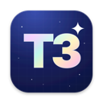
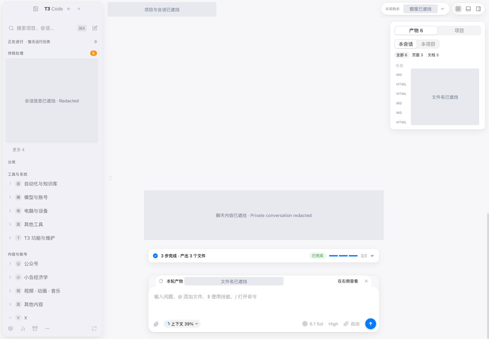
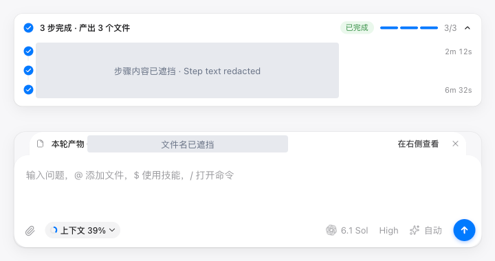
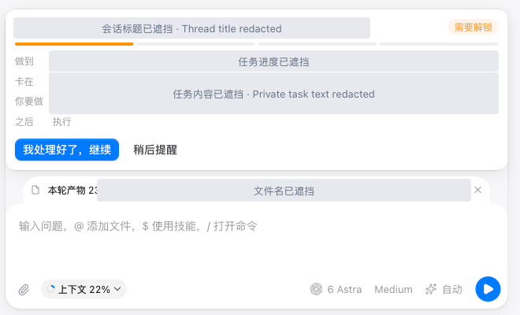
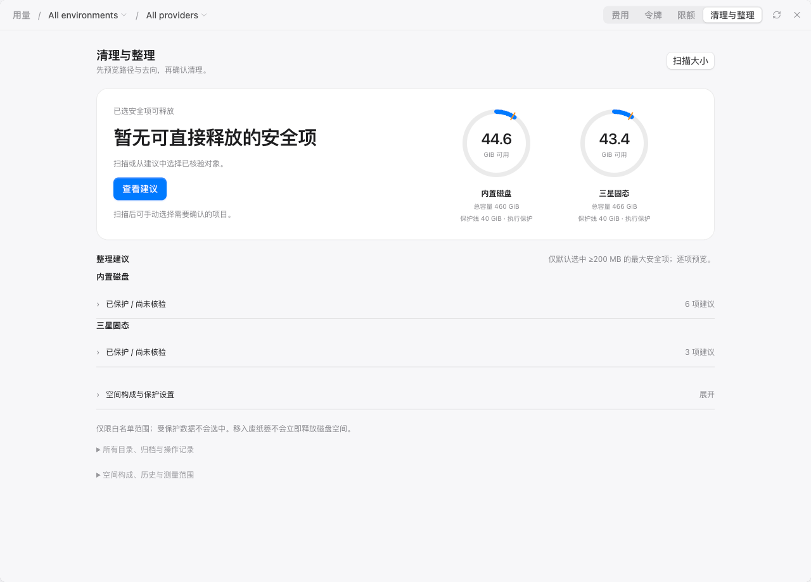

<h1 align="center">T3 Stardust · A Chinese-first AI desktop workbench built on T3 Code</h1>

Keep tasks, approvals, handoffs and artifacts in one clear workspace.

<a href="#download">Download</a> · <a href="#features">Features</a> · <a href="README.md">简体中文</a>

<!-- showcase:overview -->

<picture><source media="(prefers-color-scheme: dark)" srcset="assets/community/c67/overview-dark.png"></picture>

_Actual C67 isolated runtime, light/dark variants. Opaque masks hide private titles, quota values, filenames and conversations; no UI is redrawn. Feature crops below use the same captures._

## A clearer way to work

<table><tr><td width="50%">
<!-- showcase:progress -->
<h3>Task steps, close to the conversation</h3>
<picture><source media="(prefers-color-scheme: dark)" srcset="assets/community/c67/steps-dark.png"></picture>

Expand completed and pending steps without losing the conversation. Approvals appear inside the step card; no approval screenshot is shown because the acceptance snapshot had no pending request.

</td><td width="50%">
<h3>Resume with a clear next action</h3>
<picture><source media="(prefers-color-scheme: dark)" srcset="assets/community/c67/resume-dark.png"></picture>

See what was done, what is blocked, what you need to do and what happens next. Resume or defer from one card.

</td></tr><tr><td width="50%">
<!-- showcase:storage -->
<h3>Inspect before cleanup</h3>
<picture><source media="(prefers-color-scheme: dark)" srcset="assets/community/c67/cleanup-dark.png"></picture>

Inspect volumes and protected items before acting. Occupied space is not necessarily reclaimable space; cleanup execution is supported on macOS.

</td><td width="50%">
<h3>Apple-inspired light and dark themes</h3>
<picture><source media="(prefers-color-scheme: dark)" srcset="assets/community/c67/overview-dark.png"></picture>

A restrained palette, compact controls and the Midnight Stardust icon. Existing themes remain selectable.

</td></tr></table>

## More tools already in the workbench

_Earlier-version screenshots below preserve the public feature gallery. They use synthetic fixtures and do not depict the current theme or current model availability._

<table>
<tr>
<td width="50%">
<!-- showcase:allowances -->
<h3>Allowance controls</h3>

C37 · actual empty state without linked accounts

</td>
<td width="50%">
<!-- showcase:artifacts -->
<h3>Files and image previews</h3>

C37 · public icon and revision draft

</td>
</tr>
<tr>
<td width="50%">
<!-- showcase:context -->
<h3>Long-session context</h3>

C37 · synthetic replay counters

</td>
<td width="50%">
<!-- showcase:models -->
<h3>Model picker</h3>

C36 · free replay model catalog

</td>
</tr>
<tr>
<td width="50%">
<!-- showcase:usage -->
<h3>Usage and cost</h3>

C28 · synthetic data, API-price estimates

</td>
<td width="50%">
<!-- showcase:settings -->
<h3>Appearance settings</h3>

C37 · actual settings UI

</td>
</tr>
</table>

## Download and use

**Stardust 1.0 (build C67): macOS 13+ / Apple Silicon only.** [Download Stardust ZIP](https://github.com/zds-xiaoxin/xiaoxin-t3code/releases/download/c67-stardust/T3-Stardust-C67-macOS-arm64.zip) · [Checksums and release](https://github.com/zds-xiaoxin/xiaoxin-t3code/releases/tag/c67-stardust) · [Release notes](docs/community/c67/RELEASE.en.md). Existing C47 downloads are an earlier version.

1. Download `T3-Stardust-C67-macOS-arm64.zip` and `SHA256SUMS.txt` from the same release; run `shasum -a 256 -c SHA256SUMS.txt` with the listed files present.
2. Finish active tasks and fully quit before upgrading. Back up chats, logins and settings; keep the previous app. Extract the ZIP and copy the app to Applications.
3. The app uses ad-hoc signing and is not Apple-notarized. Follow macOS Privacy & Security prompts. Use your own provider CLI and account; subscriptions and API fees are separate.

Updates are manual. No new Intel, Windows or Linux binary is included. [Earlier Windows test build](https://github.com/zds-xiaoxin/xiaoxin-t3code/releases/tag/xiaoxin-c35-windows-test-20261102).

## Measured idle CPU

**Median 0.0% · P95 7.9% · 65 samples.** Measured on the locally installed C67 renderer in a strict idle window; this is not whole-machine CPU or a performance promise for the rebuilt public ZIP.

Measurement method and limits

Measured on 2026-11-15 after 30 seconds of settling, over approximately 90.48 seconds. P95 uses nearest rank. Windows 1–2 were discarded due to activity; window 3 passed. No screenshot, CDP connection, DOM polling or task-ledger polling during sampling. Peak: 31.8%; mean: 1.214%. Individual spikes remain unattributed. [Public numeric evidence](docs/community/c67/idle-cpu.json).

## Upstream and open source

Built on [T3 Code](https://github.com/pingdotgg/t3code), retaining its [MIT license](LICENSE). Embedded core: `0.1.7-nightly.20261103.4119`. T3 Stardust is an independent community edition, not an official T3 Code release. [Upstream README](README.upstream.md) · [Third-party notices](third-party-licenses).

The public build normalizes the cleanup staging path: `T3CODE_BUILD_STAGING_DIR`, defaulting to `~/.t3/build-staging`. It carries no maintainer profile, credentials or private signing identity. The archive and native PTY checks are documented in the release evidence.

[C47 history and benchmarks](docs/history/c47/README.en.md) · [GitHub Releases](https://github.com/zds-xiaoxin/xiaoxin-t3code/releases)
