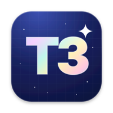

<p align="center">
  
</p>

<h1 align="center">T3 Code 星尘版 · Stardust</h1>

<p align="center">
  <a href="https://github.com/zds-xiaoxin/xiaoxin-t3-stardust/releases"><strong>Releases / 下载</strong></a> ·
  <a href="#first-open">First open</a> · <a href="#首次打开">首次打开</a> ·
  <a href="#privacy">Privacy / 隐私</a> ·
  <a href="./docs/README.md">Docs / 文档</a>
</p>

**English** · [中文](#中文)

## English

This is **T3 Code Stardust**, a community fork of the open-source [T3 Code](https://github.com/pingdotgg/t3code) (MIT). It runs the coding agents on your own machine (Claude Code, Codex, Cursor, OpenCode and any [ACP](./docs/user/providers-acp.md) agent) behind one interface, and adds a Chinese interface, multi-account quota views, step cards and background-task handling. It is not an official T3 Code release and is not affiliated with the upstream project.

### Install

Download the build for your system from [Releases](https://github.com/zds-xiaoxin/xiaoxin-t3-stardust/releases). Command line (macOS and Linux):

```bash
curl -fsSL https://raw.githubusercontent.com/zds-xiaoxin/xiaoxin-t3-stardust/main/scripts/install.sh | sh
```

On Windows, in PowerShell:

```powershell
irm https://raw.githubusercontent.com/zds-xiaoxin/xiaoxin-t3-stardust/main/scripts/install.ps1 | iex
```

T3 Code needs at least one agent that is installed and signed in, for example [Claude Code](https://claude.com/product/claude-code) (`claude auth login`) or [Codex CLI](https://developers.openai.com/codex/cli) (`codex login`). [Provider setup](./docs/user/install.md#providers) lists the steps for each agent.

### First open

macOS builds of this project are **not signed or notarized**: there is no Apple Developer ID behind them, so Apple cannot vouch for the app. macOS 15 and later therefore blocks the first launch ("Apple could not verify ... is free of malware"). Opening it anyway is your decision, and it means trusting whoever built the file you downloaded. Only open builds you downloaded from the Releases page above, and compare the checksum if one is published.

1. Open the app once and dismiss the warning.
2. Open **System Settings → Privacy & Security**, scroll to the Security section and click **Open Anyway** next to the app. Enter your password and confirm.
3. Alternative, from Terminal: remove the quarantine flag, then open the app normally.

```bash
xattr -dr com.apple.quarantine /Applications/<App>.app
```

Replace `<App>` with the name of the app in your Applications folder (for example `T3 Code (Beta)`). This only removes macOS's "downloaded from the internet" mark; it does not change the app.

### Updates

Automatic updates are **off** in this build unless its update feed points to this project's own releases. It will never update itself to an upstream T3 Code build. Install new versions from the [Releases](https://github.com/zds-xiaoxin/xiaoxin-t3-stardust/releases) page.

### Privacy

Usage statistics are **off by default**. Nothing is sent, buffered or queued until you turn on **Settings → About → Share anonymous usage data**. When it is on, anonymous usage events (feature use, app version, operating system; never prompts, files or paths) go to `ingest.t3.codes`, a server run by the upstream T3 Code project. Turning it off stops sending at once and discards events not yet sent. Setting `T3CODE_TELEMETRY_ENABLED=false` in the environment, or an administrator policy, also keeps it off. See [telemetry](./docs/user/telemetry.md).

Other network use is limited to what you start: your agents talk to their own providers, git talks to your remotes, and the web client checks GitHub for new releases of this project.

### Build from source

See the [development runbook](./docs/operations/development.md#first-checkout) and the [architecture overview](./docs/internals/overview.md). Optional environment: `T3_CLEANUP_STAGING_DIR` (absolute path of a build-staging folder the storage cleanup may inventory; unset by default).

### License

[MIT](./LICENSE). Upstream copyright notices are kept.

## 中文

**T3 Code 星尘版**是开源项目 [T3 Code](https://github.com/pingdotgg/t3code)（MIT）的社区分支：在你自己的电脑上运行编码智能体（Claude Code、Codex、Cursor、OpenCode 以及任何 [ACP](./docs/user/providers-acp.md) 智能体），提供统一界面，并增加了中文界面、多账号额度视图、步骤卡与后台任务处理。它不是 T3 Code 官方版本，与上游项目无隶属关系。

### 安装

从 [Releases](https://github.com/zds-xiaoxin/xiaoxin-t3-stardust/releases) 下载对应系统的版本。命令行安装（macOS、Linux）：

```bash
curl -fsSL https://raw.githubusercontent.com/zds-xiaoxin/xiaoxin-t3-stardust/main/scripts/install.sh | sh
```

Windows（PowerShell）：

```powershell
irm https://raw.githubusercontent.com/zds-xiaoxin/xiaoxin-t3-stardust/main/scripts/install.ps1 | iex
```

至少需要一个已安装并登录的智能体，例如 [Claude Code](https://claude.com/product/claude-code)（`claude auth login`）或 [Codex CLI](https://developers.openai.com/codex/cli)（`codex login`）。各智能体的设置步骤见[提供方设置](./docs/user/install.md#providers)。

### 首次打开

本项目的 macOS 版本**没有签名，也没有经过苹果公证**：没有 Apple Developer ID，苹果无法为这个应用担保。因此 macOS 15 及以上首次启动会被拦截（提示“Apple 无法验证……是否包含恶意软件”）。是否仍要打开由你决定，这等于信任制作你所下载文件的人。请只打开从上面 Releases 页面下载的版本，并在页面提供校验值时核对。

1. 先打开一次应用，关闭弹出的警告。
2. 打开 **系统设置 → 隐私与安全性**，滚动到“安全性”一栏，点击该应用旁的 **仍要打开**，输入密码确认。
3. 备选方法（终端）：去掉隔离标记，再正常打开应用。

```bash
xattr -dr com.apple.quarantine /Applications/<App>.app
```

把 `<App>` 换成“应用程序”文件夹中该应用的实际名称（例如 `T3 Code (Beta)`）。这条命令只会去掉 macOS 的“从互联网下载”标记，不会修改应用本身。

### 更新

除非更新源指向本项目自己的发布页，否则本版本的**自动更新为关闭状态**，也绝不会把你更新成上游 T3 Code 的版本。新版本请到 [Releases](https://github.com/zds-xiaoxin/xiaoxin-t3-stardust/releases) 页面下载安装。

### 隐私

使用统计**默认关闭**。在你于 **设置 → 关于 → 共享匿名使用数据** 中开启之前，不会发送、缓冲或排队任何数据。开启后，匿名使用事件（功能使用情况、应用版本、操作系统；不含提示词、文件或路径）会发送到 `ingest.t3.codes`，该服务由上游 T3 Code 项目运营。关闭后立即停止发送，并丢弃尚未发送的事件。在环境中设置 `T3CODE_TELEMETRY_ENABLED=false`，或由管理员策略，也会使其保持关闭。详见[遥测说明](./docs/user/telemetry.md)。

其他网络访问仅限你主动发起的操作：智能体访问它们各自的服务商，git 访问你的远端仓库，网页端会向 GitHub 查询本项目是否有新版本。

### 从源码构建

参见[开发手册](./docs/operations/development.md#first-checkout)与[架构概览](./docs/internals/overview.md)。可选环境变量：`T3_CLEANUP_STAGING_DIR`（存储清理可盘点的构建暂存目录的绝对路径，默认不设置）。

### 许可

[MIT](./LICENSE)。保留上游版权声明。
