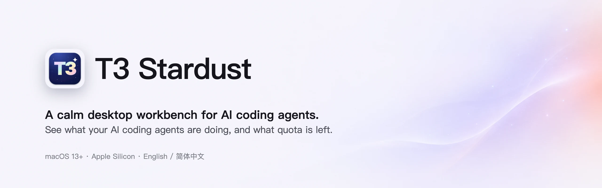
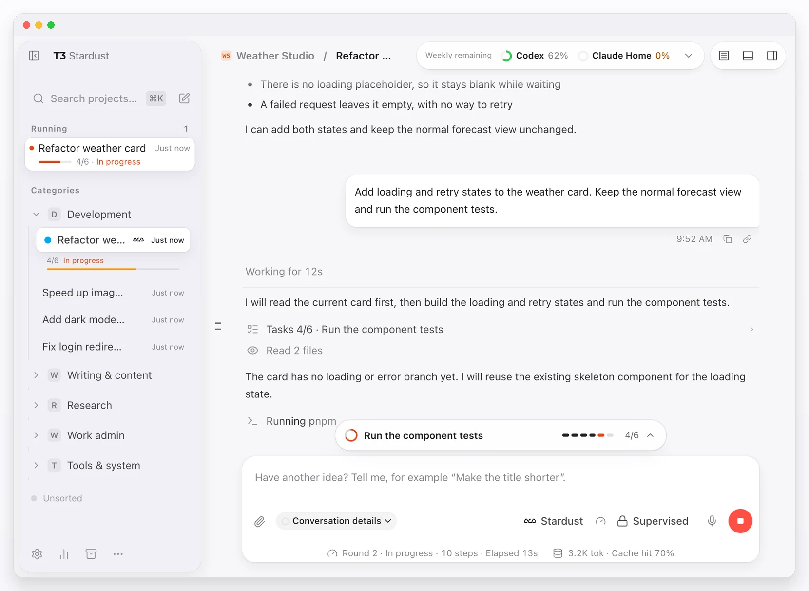
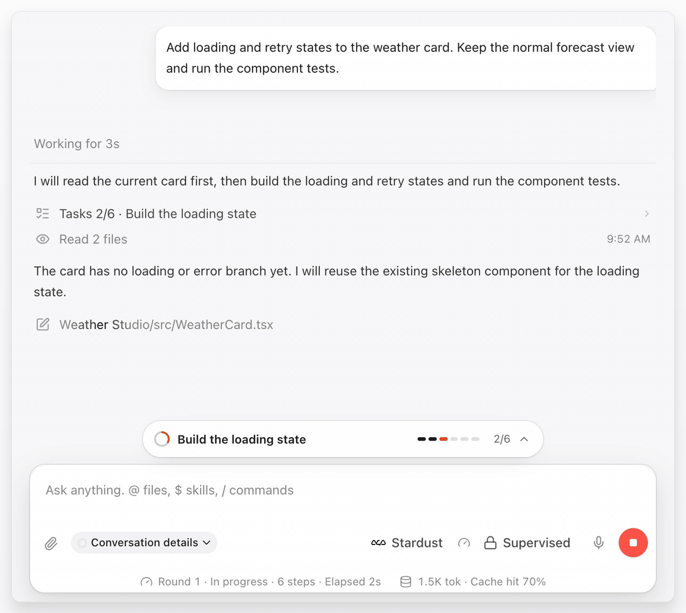
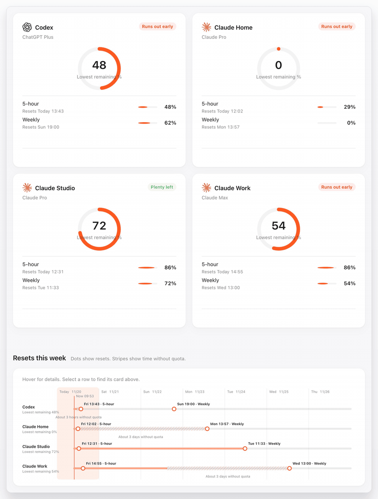
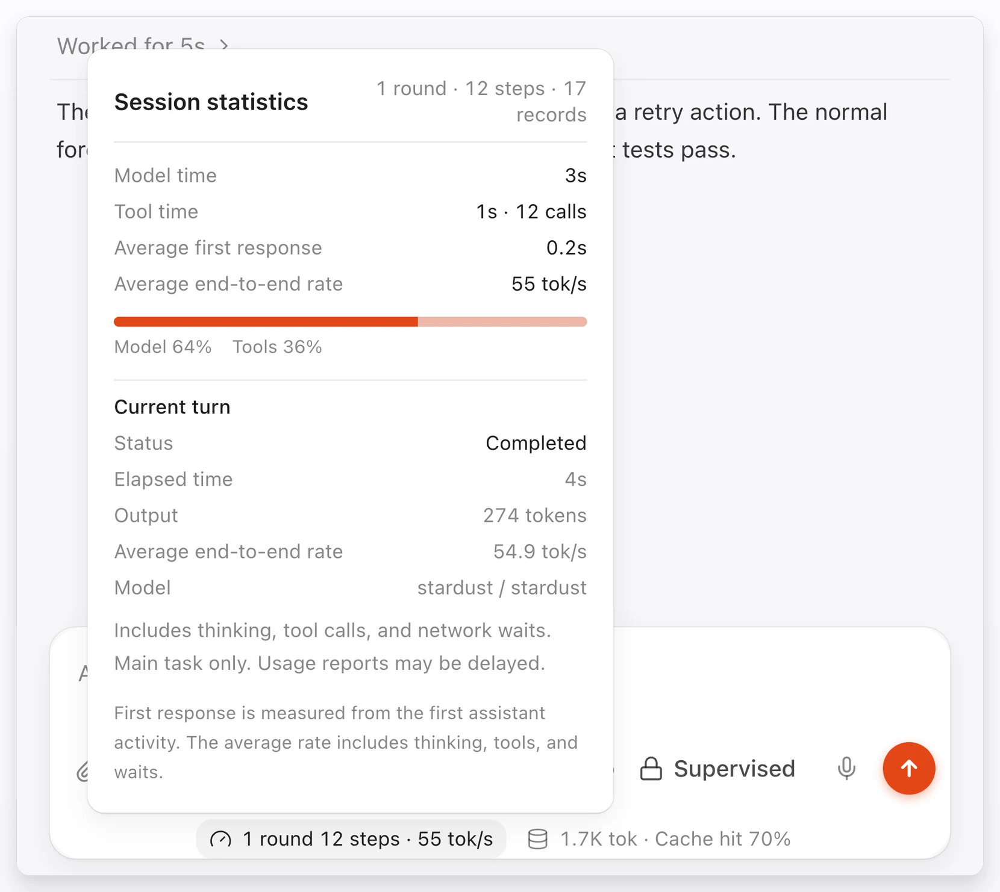
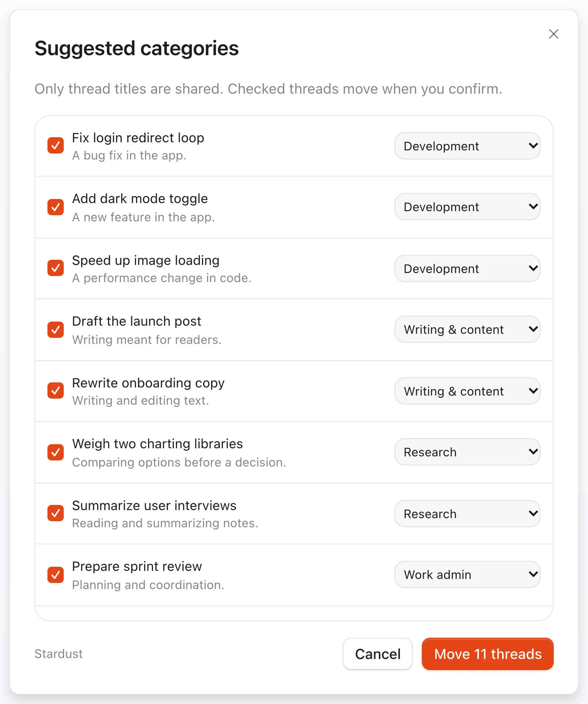
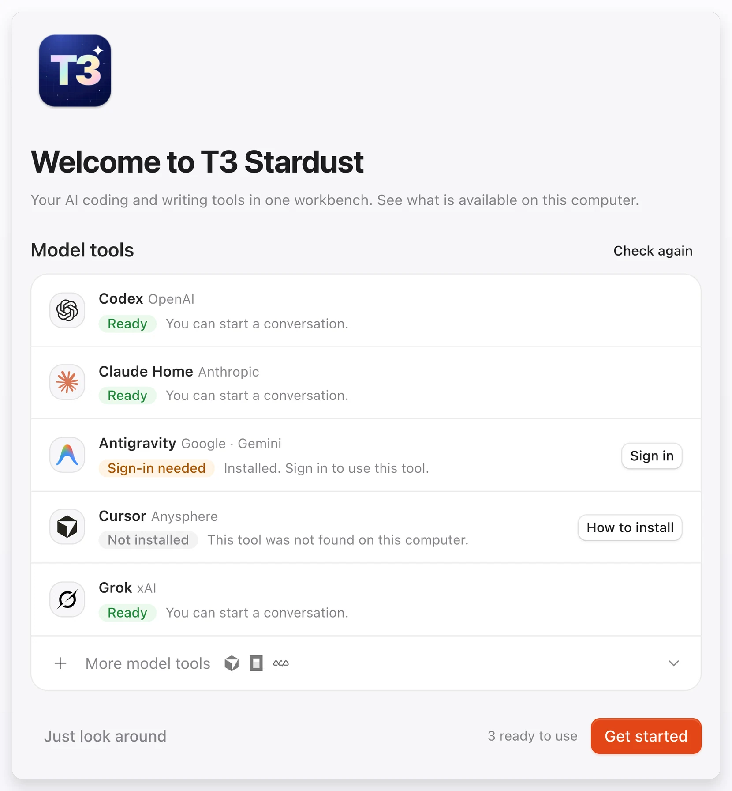
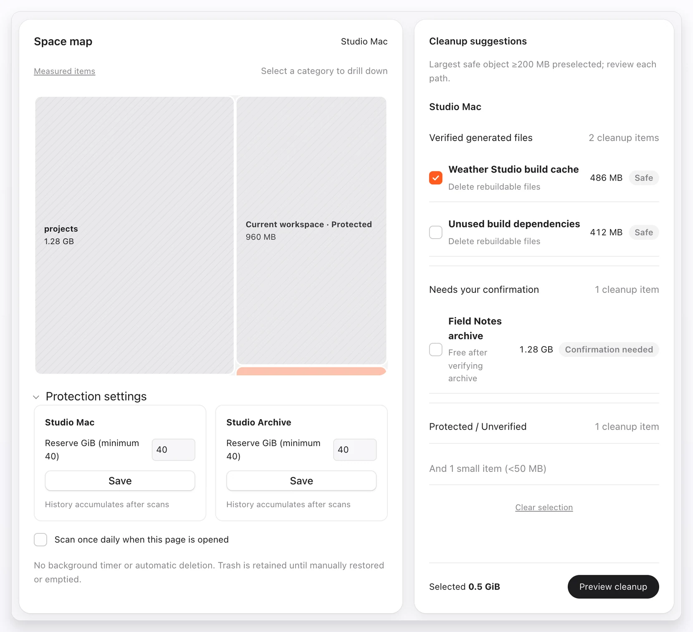

  <a href="https://github.com/zds-xiaoxin/xiaoxin-t3code/releases/latest">
    <picture>
      <source media="(prefers-color-scheme: dark)" srcset="assets/banner-en-dark.webp">
      
    </picture>
  </a>

<h1 align="center">T3 Stardust</h1>

  See what your AI coding agents are doing, and how much quota each account has left. 
  A macOS workbench for Claude, Codex and the agents you already use.

  <a href="https://github.com/zds-xiaoxin/xiaoxin-t3code/releases/latest"><b>Download for macOS (Apple Silicon)</b></a> ·
  <a href="#upgrading-from-c67-or-earlier">Upgrade &amp; backup</a> ·
  <a href="https://github.com/zds-xiaoxin/xiaoxin-t3code/releases/tag/v1.0.2">Release notes</a> ·
  <a href="#download-and-first-open">First open</a> ·
  <a href="README.zh-CN.md">简体中文</a>

  <picture>
    <source media="(prefers-color-scheme: dark)" srcset="assets/hero-en-dark.webp">
    
  </picture>

T3 Stardust is a desktop workbench for the AI coding agents you already use, such as Claude and Codex. It shows what each agent is doing, how much quota each account has left, and keeps your chats sorted. It runs on your Mac and works with your own subscriptions.

> [!NOTE]
> **Formerly Xiaoxin T3 Code, now T3 Stardust.** Same repository, same project; earlier releases (C67, C47 and before) stay on the releases page.
>
> An unofficial community edition of [T3 Code](https://github.com/pingdotgg/t3code) (MIT). Not affiliated with T3 Tools. Report Stardust issues here, not upstream.

## What you get

### See the plan, not a wall of commands

A small capsule floats above the composer and shows where the agent is: three to six milestones, one ring, one count. Open it to see each stage and what it did. It works with Claude and Codex.

<picture>
  <source media="(prefers-color-scheme: dark)" srcset="assets/steps-en-dark.gif">
  
</picture>

### Know which account has quota left

Each Claude login gets its own card, so two accounts never blur into one number. **Resets this week** shows when every limit comes back, and the gap between running out and the next reset.

<picture>
  <source media="(prefers-color-scheme: dark)" srcset="assets/quota-en-dark.gif">
  
</picture>

### Stats from the first turn

Steps, speed, tokens and cache hits sit under the composer and grow while the first turn is still running. Click for the full breakdown.

<picture>
  <source media="(prefers-color-scheme: dark)" srcset="assets/stats-en-dark.webp">
  
</picture>

### A sidebar that sorts itself

Pick a preset and new chats file themselves by title. Ask for suggestions and review them first. Nothing moves until you confirm.

<picture>
  <source media="(prefers-color-scheme: dark)" srcset="assets/categories-en-dark.webp">
  
</picture>

### A first run that says what is ready, and cleanup you preview first

The welcome page checks which tools on this Mac are installed and signed in (for example Codex, Claude, Antigravity and Cursor), in plain words. Cleanup lists what it would remove and how much space that frees. You decide.

<table>
  <tr>
    <td width="50%">
      <picture>
        <source media="(prefers-color-scheme: dark)" srcset="assets/welcome-en-dark.webp">
        
      </picture>
    </td>
    <td width="50%">
      <picture>
        <source media="(prefers-color-scheme: dark)" srcset="assets/cleanup-en-dark.webp">
        
      </picture>
    </td>
  </tr>
</table>

Everything above is the real app. The screens use demo data and no model calls.

## Download and first open

**Requires macOS 13 or later on Apple Silicon (M1 or newer).** There is no Intel, Windows or Linux build yet.

1. Download the `.zip` from the [latest release](https://github.com/zds-xiaoxin/xiaoxin-t3code/releases/latest), unzip it and drag the app to Applications.
2. The app is **ad-hoc signed, not signed with an Apple Developer ID, not notarized**, so macOS blocks the first launch. Try to open it once, then go to **System Settings → Privacy & Security**, scroll down and click **Open Anyway**. On macOS 13 and 14 you can also right-click the app and choose **Open**.
3. Sign in to the agents you already use. T3 Stardust does not sell model access. You sign in to the agents you already pay for.

Check the download if you like: download `SHA256SUMS.txt` from the release into the same folder and run `shasum -a 256 -c SHA256SUMS.txt`.

Usage analytics are **off** by default. You can turn them on in Settings → About.

Updates are manual for now. Watch the [releases page](https://github.com/zds-xiaoxin/xiaoxin-t3code/releases).

## Upgrading from C67 or earlier

1. **Quit the old app completely**, then make a cold backup of your data folder: copy `~/.t3` somewhere safe.
2. Install and open T3 Stardust. It migrates your data on first launch.
3. **The migration goes one way** (database schema 79 → 95). Keep the old app, but do not open the migrated data with it, or it may overwrite newer data with an older database.

**To go back:**

1. Quit the new T3 Stardust completely.
2. Rename the migrated data folder, for example `~/.t3` → `~/.t3-migrated`. Keep it; do not delete it yet.
3. Copy your backup back to `~/.t3`.
4. Open the old app.

## Privacy and data

- Local first. Chat records, settings and the database are stored on your Mac.
- When you run an agent, your requests are handled by the service you chose for it. T3 Stardust does not add its own server in between.
- Category suggestions send chat titles to the model you choose, only after you click, and may use that account's quota.
- Analytics are off until you opt in. In the default configuration this edition does not check upstream for updates.
- The package has no maintainer data in it. Releases are scanned for personal paths, account names and keys before they ship. How we check: [docs/VERIFY.md](docs/VERIFY.md).

## FAQ

**Is this the official T3 Code?** No. It is a community edition built on T3 Code under the MIT license, with its own interface changes.

**The step capsule does not show up.** It appears when the agent makes a task list. Some Claude sessions never create one, so there is nothing to show.

**Will it use my quota?** When you run an agent, yes, as usual. Asking for category suggestions sends titles to a model and may use quota too. Viewing quota, stats and the cleanup preview does not call a model.

**Can I go back to the old app?** Yes, with the cold backup from the upgrade steps. Do not point the old app at migrated data.

**Where do I report a bug?** [Open an issue](https://github.com/zds-xiaoxin/xiaoxin-t3code/issues/new). Remove names, paths and keys from logs first.

## Credits and license

Built on [T3 Code](https://github.com/pingdotgg/t3code) by T3 Tools Inc. under the [MIT license](LICENSE), with the original copyright kept. Third-party notices are in [third-party-licenses](third-party-licenses/). Checks and checksums: [docs/VERIFY.md](docs/VERIFY.md).
