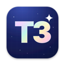
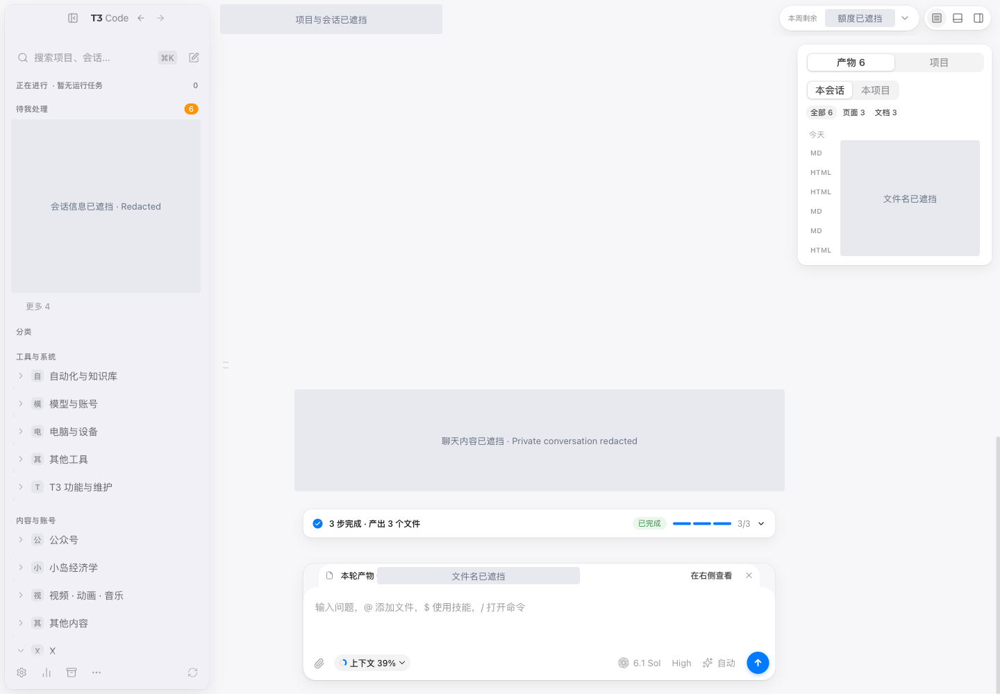
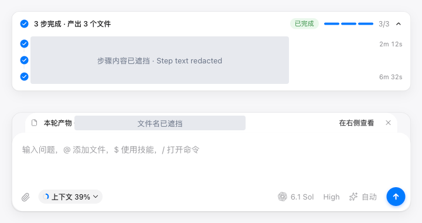
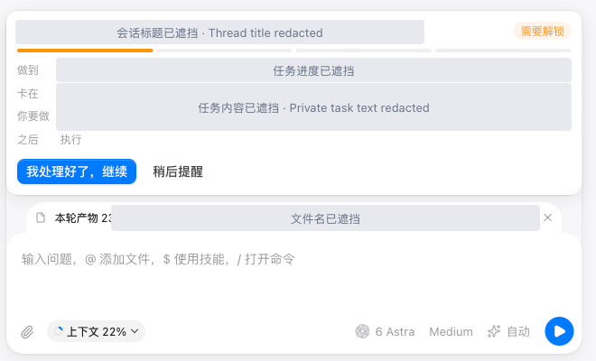
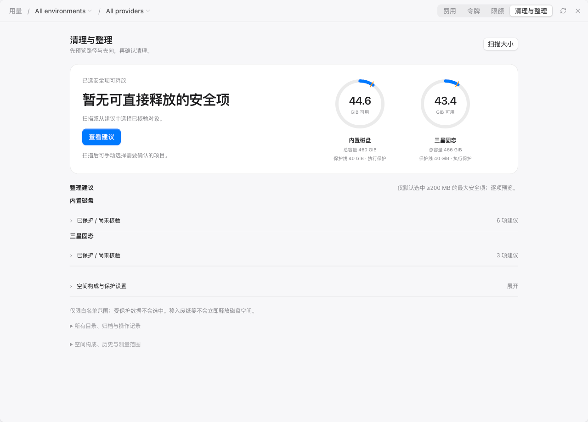

<h1 align="center">T3 星尘版 · 站在 T3 Code 肩膀上的中文 AI 桌面工作台</h1>

把任务步骤、审批、接续与产物，放进一个清楚的工作台。

<a href="#download">下载</a> · <a href="#features">特性</a> · <a href="README.en.md">English</a>

<!-- showcase:overview -->

<picture><source media="(prefers-color-scheme: dark)" srcset="assets/community/c67/overview-dark.png"></picture>

_C67 真实隔离运行截图，自动适配深浅色。实色遮挡会话标题、账号额度、文件名与聊天内容；没有重绘 UI。下方局部图来自同批截图。_

## 让每一步都有着落

<table><tr><td width="50%">
<!-- showcase:progress -->
<h3>任务步骤，就在对话里</h3>
<picture><source media="(prefers-color-scheme: dark)" srcset="assets/community/c67/steps-dark.png"></picture>

展开查看步骤与完成状态，不用离开对话。审批进入步骤卡，在对应任务里处理；验收快照没有待审批实例，因此此处只作文字说明。

</td><td width="50%">
<h3>中断之后，接得上</h3>
<picture><source media="(prefers-color-scheme: dark)" srcset="assets/community/c67/resume-dark.png"></picture>

接续卡说明做到哪里、卡在哪里、你要做什么，以及之后的动作。处理后继续，也可以稍后提醒。

</td></tr><tr><td width="50%">
<!-- showcase:storage -->
<h3>清理之前，先看清楚</h3>
<picture><source media="(prefers-color-scheme: dark)" srcset="assets/community/c67/cleanup-dark.png"></picture>

按卷查看空间、建议和保护项，先预览路径与去向。占用量不等于可释放量；清理执行器当前支持 macOS。

</td><td width="50%">
<h3>苹果主题，深浅都清楚</h3>
<picture><source media="(prefers-color-scheme: dark)" srcset="assets/community/c67/overview-dark.png"></picture>

克制的层次、紧凑的控件，搭配「午夜星尘」图标。原有主题仍可选择。

</td></tr></table>

## 工作台里已有的工具

_以下保留历史版本功能图库，均为已公开的隔离示例；不是当前主题、模型目录或真实账单。_

<table>
<tr>
<td width="50%">
<!-- showcase:allowances -->
<h3>额度入口</h3>

C37 · 未连接账号的真实空状态

</td>
<td width="50%">
<!-- showcase:artifacts -->
<h3>文件与图片预览</h3>

C37 · 公开图标与修改草稿

</td>
</tr>
<tr>
<td width="50%">
<!-- showcase:context -->
<h3>长会话上下文</h3>

C37 · 回放示例计数

</td>
<td width="50%">
<!-- showcase:models -->
<h3>模型选择</h3>

C36 · 免费回放模型目录

</td>
</tr>
<tr>
<td width="50%">
<!-- showcase:usage -->
<h3>用量与费用</h3>

C28 · 合成数据，API 标价估算

</td>
<td width="50%">
<!-- showcase:settings -->
<h3>中文外观设置</h3>

C37 · 实际设置界面

</td>
</tr>
</table>

## 下载与使用

**星尘版 1.0（构建 C67）：仅 macOS 13+ / Apple Silicon。** [下载星尘版 ZIP](https://github.com/zds-xiaoxin/xiaoxin-t3code/releases/download/c67-stardust/T3-Stardust-C67-macOS-arm64.zip) · [校验与发行页](https://github.com/zds-xiaoxin/xiaoxin-t3code/releases/tag/c67-stardust) · [发行说明](docs/community/c67/RELEASE.zh.md)。现有 C47 下载属于旧版本。

1. 从同一发行页下载 `T3-Stardust-C67-macOS-arm64.zip` 和 `SHA256SUMS.txt`；文件齐全后运行 `shasum -a 256 -c SHA256SUMS.txt`。
2. 升级前结束任务并完全退出，备份聊天、登录与设置，保留旧 App；解压 ZIP 后将应用复制到 Applications。
3. 公开包使用 ad-hoc 签名，未经过 Apple 公证；按 macOS「隐私与安全性」提示打开。使用你自己的提供方 CLI 与账号，订阅和 API 费用另计。

仅手动更新；本轮没有新的 Intel、Windows 或 Linux 包。[已有 Windows 测试版](https://github.com/zds-xiaoxin/xiaoxin-t3code/releases/tag/xiaoxin-c35-windows-test-20261102)。

## 空闲 CPU 实测

**中位数 0.0% · P95 7.9% · 65 个样本。** 来自本机已安装 C67 的渲染进程严格空闲窗口；不是整机 CPU，也不是重建公开包在所有设备上的性能承诺。

测量方法与边界

测于 2026-11-15。先静置 30 秒，采样窗口约 90.48 秒；P95 使用 nearest rank。前两个窗口因活动作废，第 3 个窗口有效。采样期间没有截图、CDP、DOM 或任务账本轮询。峰值 31.8%，均值 1.214%；单点尖峰尚未归因。[公开数值证据](docs/community/c67/idle-cpu.json)。

## 上游与开源致谢

基于 [T3 Code](https://github.com/pingdotgg/t3code)，保留上游 [MIT 许可证](LICENSE)。内嵌内核为 `0.1.7-nightly.20261103.4119`。T3 星尘版是独立社区发行版，不是官方版本。[上游 README](README.upstream.md) · [第三方许可](third-party-licenses)。

公开构建将清理暂存目录改为 `T3CODE_BUILD_STAGING_DIR` 可配置，默认 `~/.t3/build-staging`；不携带维护者用户数据、凭据或私有签名身份。包检查与原生 PTY 证据随发行材料提供。

[C47 历史介绍与实测记录](docs/history/c47/README.md) · [GitHub Releases](https://github.com/zds-xiaoxin/xiaoxin-t3code/releases)
