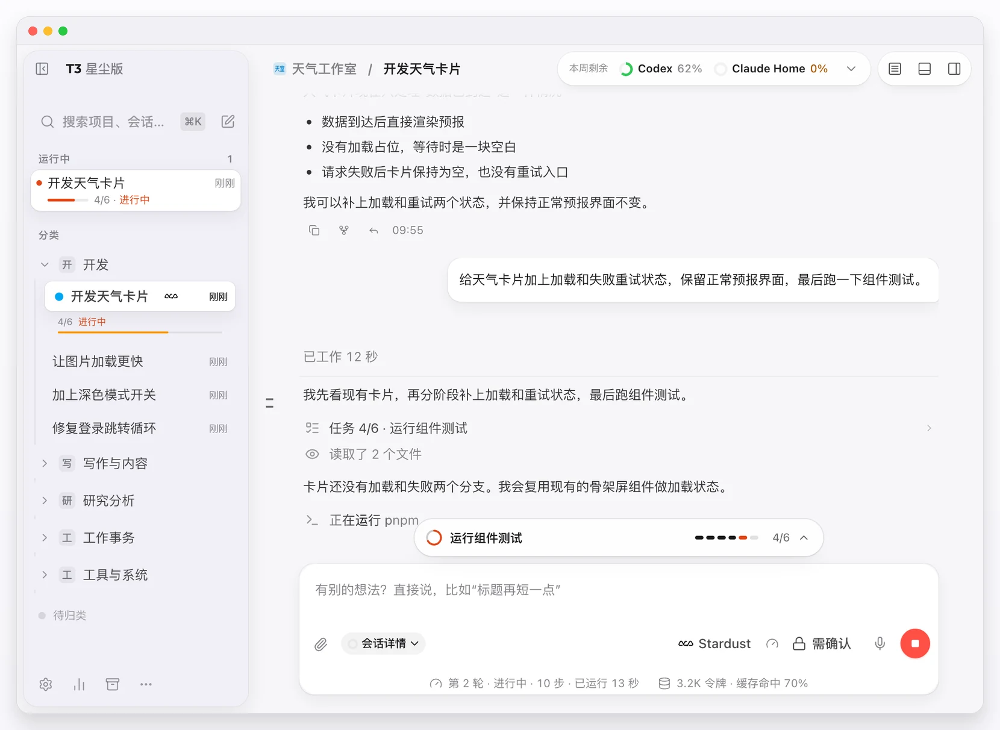
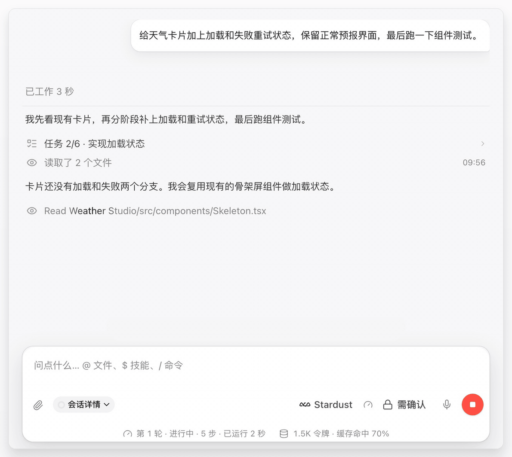
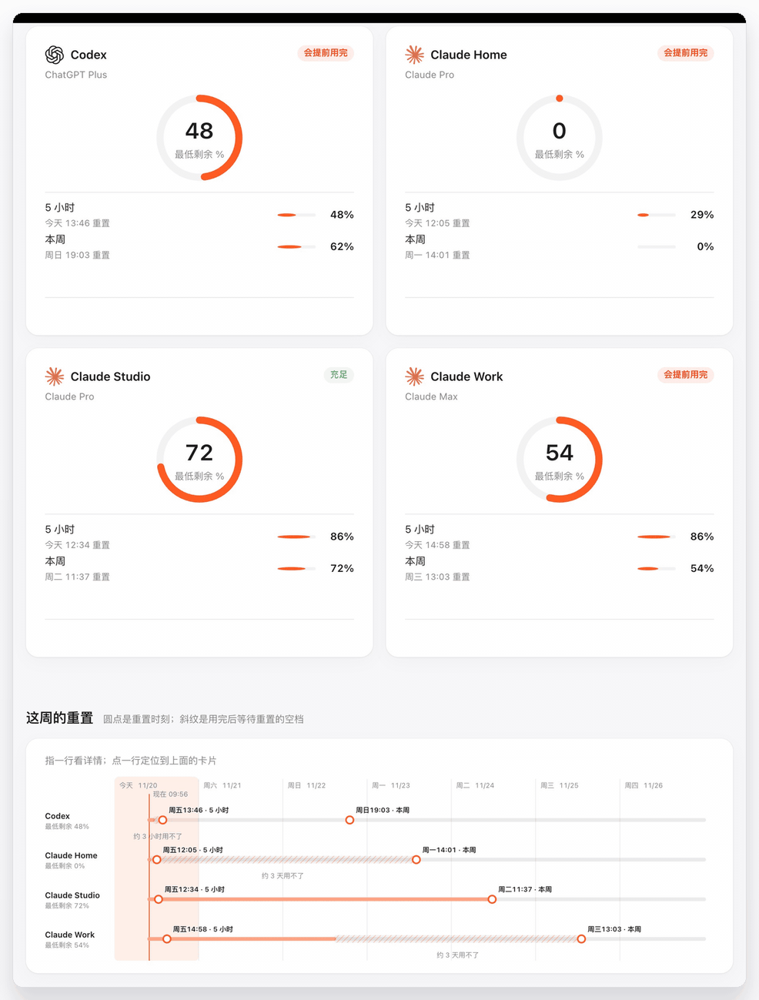
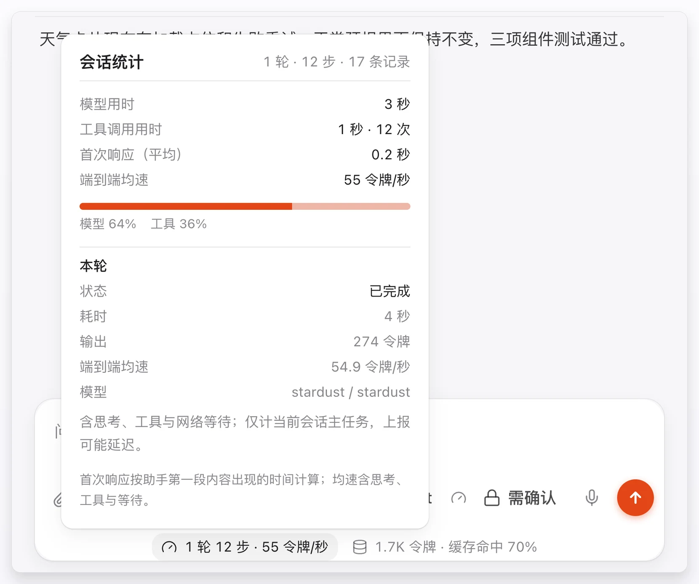
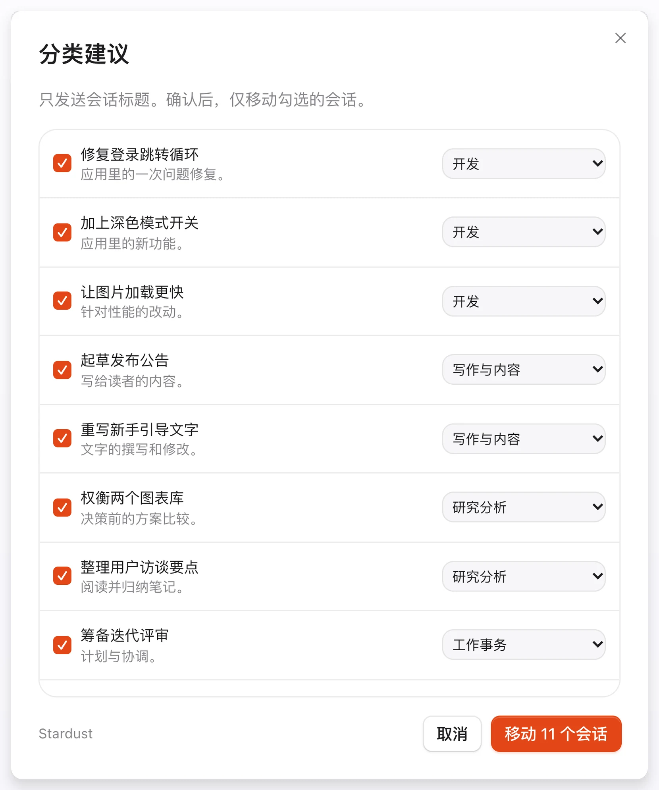
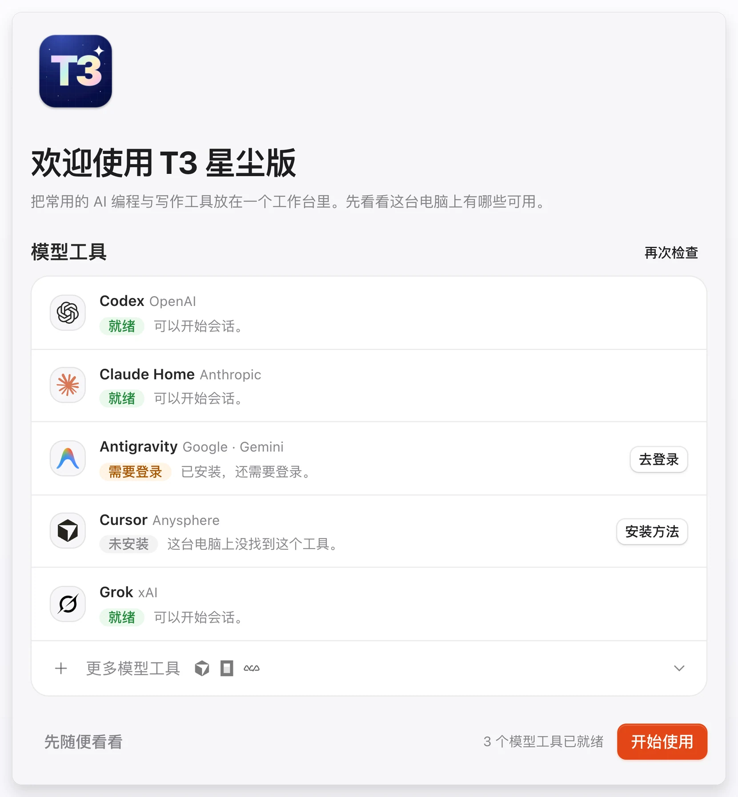
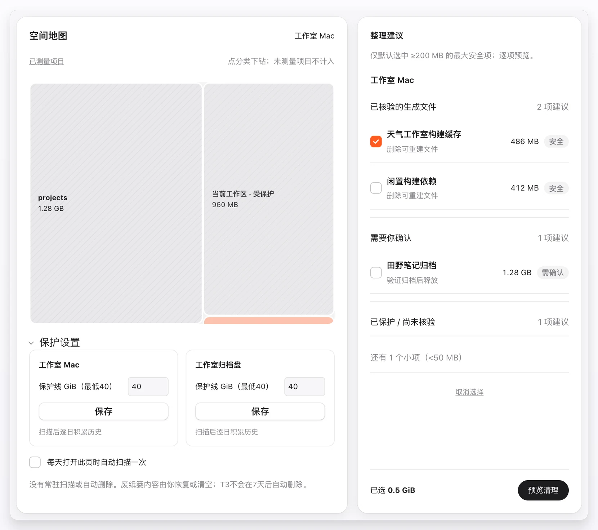

  <a href="https://github.com/zds-xiaoxin/xiaoxin-t3code/releases/latest">
    <picture>
      <source media="(prefers-color-scheme: dark)" srcset="assets/banner-zh-dark.webp">
      
    </picture>
  </a>

<h1 align="center">T3 星尘版</h1>

  看清 AI 编码助手在做什么，还剩多少额度。 
  给 Claude、Codex 等你已在用的助手准备的 macOS 工作台。

  <a href="https://github.com/zds-xiaoxin/xiaoxin-t3code/releases/latest"><b>下载 macOS 版（Apple 芯片）</b></a> ·
  <a href="#从-c67-或更早版本升级">升级与备份</a> ·
  <a href="https://github.com/zds-xiaoxin/xiaoxin-t3code/releases/tag/v1.0.0">更新说明</a> ·
  <a href="#下载与首次打开">首次打开</a> ·
  <a href="README.md">English</a>

  <picture>
    <source media="(prefers-color-scheme: dark)" srcset="assets/hero-zh-dark.webp">
    
  </picture>

T3 星尘版是给你已经在用的 AI 编码助手（比如 Claude 和 Codex）准备的桌面工作台。它告诉你每个助手正在做什么、每个账号还剩多少额度，并替你把会话分好类。它运行在你的 Mac 上，用的是你自己的订阅。

> [!NOTE]
> **原 Xiaoxin T3 Code，现名 T3 星尘版。** 同一个仓库、同一个项目；之前的版本（C67、C47 及更早）仍保留在 Releases 页面。
>
> 这是 [T3 Code](https://github.com/pingdotgg/t3code)（MIT）的非官方社区版，与 T3 Tools 无关联。星尘版的问题请在本仓库反馈，不要发到上游。

## 你会得到什么

### 看计划，不看命令堆

输入框上方有一个悬浮的小胶囊，告诉你助手做到哪了：三到六个阶段、一个进度环、一个计数。点开能看到每个阶段和它做过的操作。支持 Claude 和 Codex。

<picture>
  <source media="(prefers-color-scheme: dark)" srcset="assets/steps-zh-dark.gif">
  
</picture>

### 知道哪个账号还有额度

每个 Claude 登录都有自己的一张卡，两个账号不会混成一个数字。「这周的重置」时间轴显示每个限额什么时候恢复，以及额度用完、下次重置前的那段空档。

<picture>
  <source media="(prefers-color-scheme: dark)" srcset="assets/quota-zh-dark.gif">
  
</picture>

### 第一轮就有统计

步骤数、速度、令牌和缓存命中显示在输入框下方，第一轮还在运行时就会跟着增长。点一下看完整明细。

<picture>
  <source media="(prefers-color-scheme: dark)" srcset="assets/stats-zh-dark.webp">
  
</picture>

### 会自己分类的侧栏

选一个预设，新会话会按标题自动归类。也可以请模型给出建议，先看清楚再决定，确认之前什么都不会移动。

<picture>
  <source media="(prefers-color-scheme: dark)" srcset="assets/categories-zh-dark.webp">
  
</picture>

### 首次打开说清楚哪些已就绪，清理前先预览

欢迎页用大白话告诉你这台 Mac 上哪些工具已安装、已登录（例如 Codex、Claude、Antigravity、Cursor）。清理会先列出要删什么、能腾出多少空间，由你决定。

<table>
  <tr>
    <td width="50%">
      <picture>
        <source media="(prefers-color-scheme: dark)" srcset="assets/welcome-zh-dark.webp">
        
      </picture>
    </td>
    <td width="50%">
      <picture>
        <source media="(prefers-color-scheme: dark)" srcset="assets/cleanup-zh-dark.webp">
        
      </picture>
    </td>
  </tr>
</table>

以上都是真实的应用界面，演示数据，没有调用任何模型。

## 下载与首次打开

**需要 macOS 13 及以上，Apple 芯片（M1 或更新）。** 暂无 Intel、Windows、Linux 版本。

1. 从[最新版本](https://github.com/zds-xiaoxin/xiaoxin-t3code/releases/latest)下载 `.zip`，解压后把应用拖进「应用程序」。
2. 应用**只做了 ad-hoc 签名，没有 Apple Developer ID 签名，也未经公证**，所以 macOS 会拦截第一次打开。先尝试打开一次，然后进入**系统设置 → 隐私与安全性**，往下滚动，点击**仍要打开**。macOS 13 和 14 也可以右键点击应用，选择**打开**。
3. 登录你已经在用的助手。T3 星尘版不代售模型额度。你登录自己已经在用的助手，费用仍由那些服务商收取。

想核对下载文件：把发布页上的 `SHA256SUMS.txt` 下载到同一个文件夹，运行 `shasum -a 256 -c SHA256SUMS.txt`。

使用统计**默认关闭**，可以在「设置 → 关于」里打开。

暂时需要手动更新，请关注[发布页](https://github.com/zds-xiaoxin/xiaoxin-t3code/releases)。

## 从 C67 或更早版本升级

1. **先彻底退出旧版本**，然后给数据目录做一份冷备份：把 `~/.t3` 复制到安全的地方。
2. 安装并打开 T3 星尘版，首次启动时会迁移数据。
3. **迁移是单向的**（数据库 schema 79 → 95）。请保留旧版应用，但不要再用它打开已迁移的数据，否则旧版可能用旧数据库覆盖新数据。

**要回退：**

1. 彻底退出新版 T3 星尘版。
2. 把迁移后的数据文件夹改名，例如 `~/.t3` → `~/.t3-migrated`，先留着，不要删。
3. 把你的备份复制回 `~/.t3`。
4. 打开旧版应用。

## 隐私与数据

- 本地优先。会话记录、设置和数据库保存在你的 Mac 上。
- 运行助手时，请求由你选择的服务处理；T3 星尘版不会在中间加自己的服务器。
- 分类建议会把会话标题发给你选的模型，只在你点击之后才发，并可能消耗该账号的额度。
- 使用统计默认关闭，需要你主动开启。默认配置下本版本不会向上游检查更新。
- 安装包里不含维护者的数据。每次发布前都会扫描个人路径、账号名和密钥。检查方式见 [docs/VERIFY.md](docs/VERIFY.md)。

## 常见问题

**这是官方的 T3 Code 吗？** 不是。它是基于 T3 Code、遵循 MIT 许可的社区版，界面有自己的改动。

**看不到步骤胶囊。** 只有助手创建了任务清单才会出现。有些 Claude 会话从不创建清单，所以没什么可显示的。

**会消耗我的额度吗？** 运行助手时会，和平时一样。请求分类建议会把标题发给模型，也可能消耗额度。查看额度、统计和清理预览不会调用模型。

**能退回旧版本吗？** 可以，用升级步骤里的冷备份。不要让旧版去打开已迁移的数据。

**Bug 去哪里报？** [提交 Issue](https://github.com/zds-xiaoxin/xiaoxin-t3code/issues/new)。贴日志前请先去掉姓名、路径和密钥。

## 致谢与许可

基于 T3 Tools Inc. 的 [T3 Code](https://github.com/pingdotgg/t3code)，遵循 [MIT 许可](LICENSE)，保留原始版权。第三方声明见 [third-party-licenses](third-party-licenses/)。检查与校验和：[docs/VERIFY.md](docs/VERIFY.md)。
